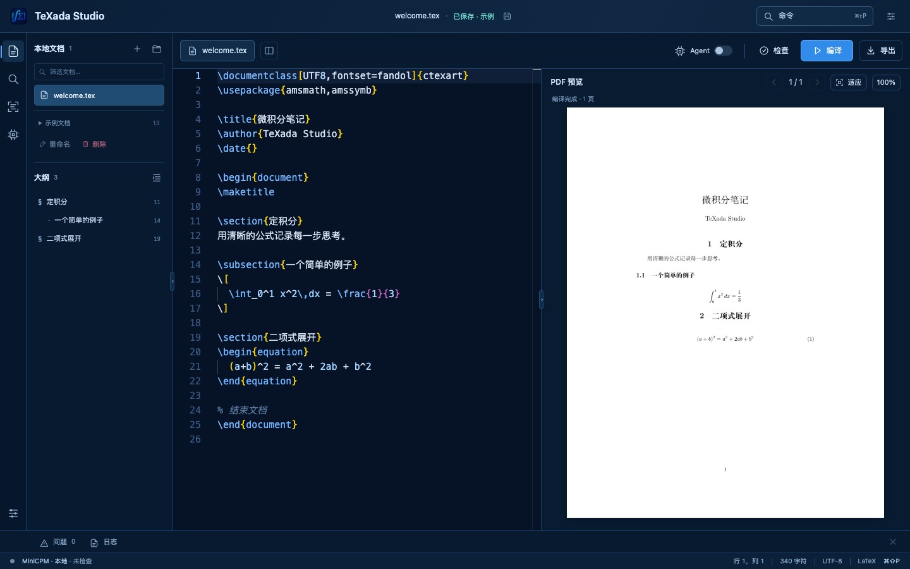

# TeXada Studio Local

Edit LaTeX, transcribe images or PDFs, check formulas and simple totals, review repair diffs, then save, compile and export on your own computer.

Studio is a local workspace opened in your browser. Documents and run records stay on your machine; image transcription and model candidates use the local model service you configure.

[中文](README.md) · [Start](#start) · [Local guide](docs/local-studio.md) · [AgentSkills](docs/agent-skills.md) · [Documentation](docs/index.md)



Current UI, using the repository's synthetic `welcome.tex` sample; November 4, 2026.

This remains a local, single-user development candidate, with no formal release for this revision. See the [current verification record](docs/current-validation.md); historical videos and experiments retain their own dates and versions.

## What you can do

| Task | Workflow |
| --- | --- |
| Manage documents | Import or create `.tex`, save, rename, and delete; saved changes survive refresh |
| Transcribe sources | Import PNG, JPEG, WebP, or PDF, up to five pages per request; review the candidate before creating a document |
| Edit and inspect | LaTeX highlighting, snippets and symbols, five document templates, find/replace, section outline, command palette, formula syntax checks, and simple totals |
| Review repairs | Source-preserving deterministic syntax repairs first; model candidates require syntax and mutation-scope checks before explicit review |
| Preview and export | Compile the current document, browse PDF pages, and export PDF, `.tex`, or an audit report |
| Connect a local model | Save a loopback endpoint and model name, then explicitly check availability |

Saving checks the file revision before replacing it. Edits invalidate an older PDF, so export requires compilation of the current content. Repository samples remain unchanged; saving creates a local copy.

Formula repair follows Math Agent's source-preservation approach: close unambiguous syntax, recheck it, and reject changed numbers, variables, operators or deleted terms. Missing operands and unsupported notation remain manual items. See the [repair-quality record](docs/formula-repair-quality.md) for the bounded policy and comparison evidence.

The activity rail opens document navigation, search, image/PDF import and Agent review. Check results appear in the bottom problems panel; create and review repair candidates through Agent. The Agent drawer and bottom problems/log panels can collapse. The export menu offers the current LaTeX and its compiled PDF.

Open the command palette with `Cmd/Ctrl+Shift+P`, navigate sections through the outline, and use the editor's find/replace panels. Font size, word wrap, and minimap preferences persist in your browser. Local LaTeX snippets — common commands, theorem-class environments, Greek letters and math symbols — need no model call; `Ctrl+Space` can request suggestions. The sidebar's "new from template" action creates documents from five offline skeletons: blank article, lecture notes, exam paper, Beamer, and English article. The status bar shows cursor, selection, and word counts.

## Start

Requires **Python 3.11+**. The example uses an installed `python3.13`; substitute another supported version if needed:

```bash
git clone https://github.com/CacinieP/TeXada-Studio-with-agentskills.git
cd TeXada-Studio-with-agentskills
python3.13 -m venv .venv
.venv/bin/python -m pip install -r webui/requirements.txt
.venv/bin/python scripts/run-local-studio.py --check
./scripts/start-local-studio.command
```

On macOS, you can double-click `scripts/start-local-studio.command` after installing dependencies. The launcher opens your browser. Its private entry URL is stored in an owner-only `session.json` in the user data directory; access credentials are not printed. Stop the launcher with `Ctrl+C`.

Initial installation of dependencies, model weights, fonts, and TeX resources may require network access. Studio compiles against cached TeX resources and does not silently download packages while processing documents. Prepare the resources needed by your documents before using compilation offline. See [first-time setup](docs/local-studio.md#首次准备与离线使用).

Run `.venv/bin/python scripts/prepare-local-tex.py` to check the fixed TeX sample offline. When needed, explicitly add `--download-resources` for initial preparation, then repeat the offline check.

Monaco assets are bundled with the source; no frontend build is required. See [source packaging](docs/source-package.md) for archive contents and checksums. A source ZIP still requires Python and the optional tools listed below.

| Feature | Additional requirements |
| --- | --- |
| Editing and deterministic checks | Python dependencies above; Monaco is bundled |
| Model candidates and image transcription | A local MiniCPM-V 4.7 1B service; automatic startup also needs `llama-server`, GGUF and projector. Deterministic repairs need no model |
| PDF import | Poppler's `pdfinfo` and `pdftoppm` |
| PDF compilation and preview | Tectonic, Poppler, required TeX cache, and fonts |

To reuse an existing local service:

```bash
.venv/bin/python scripts/run-local-studio.py \
  --base-url http://127.0.0.1:18081/v1 \
  --model MiniCPM-V-4.7-1B --no-auto-model
```

Local mode accepts only HTTP endpoints on `localhost`, `127.0.0.1`, or `[::1]`. It needs no API key and has no cloud fallback. The launcher reuses existing services and stops only model processes it started itself. See the [model guide](docs/local-studio.md#本机模型连接) for model sources and path options.

## First document

1. Open `welcome.tex` or `math-clean.tex` and choose **Check**. Once compiler dependencies are ready, choose **Compile**.
2. Open `math-delimiters.tex`, generate a candidate, review the diff, and accept or reject it. Save after adopting a candidate.
3. Refresh to check persistence, then export the current `.tex` or PDF.
4. Select an authorized image or PDF, start recognition, review it against the original, and create a document from the candidate.

Use **Save** or `⌘/Ctrl+S` to persist edits. OCR and repair candidates do not automatically replace the source.

## Scope

The TeX scanner skips comments, common literal environments, and command definitions. It recognizes `$...$`, `$$...$$`, `\(...\)`, `\[...\]`, and common math environments. Complex alignments, unknown macros, and unsupported expressions remain for human review.

Syntax acceptance, compilation, faithful transcription, and mathematical correctness are separate judgments. A false equation can compile successfully. Review OCR, repairs, and table findings against the original.

The current unit of work is one `.tex` file. Multi-file projects and multi-user collaboration are outside this local version's scope. See the [roadmap](docs/roadmap.md).

## Samples and development

The [local guide](docs/local-studio.md#开发与复现) retains the model-free CLI example, test commands, and research protocols.

- [Studio operation Skill](skills/texada-studio/SKILL.md) and [AgentSkills guide](docs/agent-skills.md): workspace operations, formula/table/OCR inputs and review boundaries.
- [Current validation](docs/current-validation.md), [source packaging](docs/source-package.md), [architecture](docs/architecture.md), and [CLI Harness](harness/README.md).

- [Casebook](docs/casebook.md), [historical validation](docs/validation.md), and [Skill comparison](docs/skills-pilot-analysis.md).
- [Skill design](docs/skills-technical-report.md), [constrained planning](docs/studio-constrained-planner.md), [Skill selection](docs/studio-skill-selection.md), and [formula handoff](docs/studio-formula-handoff.md).
- [TeXada series](docs/texada-series.md) and [Math Agent](https://github.com/CacinieP/TeXada-the-Math-Agent) for complementary formula input and document review.
- Historical demonstration: [video](https://www.bilibili.com/video/BV16Kan6rEGv/), [recording evidence](docs/dynamic-demo.md), [WeChat article](https://mp.weixin.qq.com/s/kDkmQp12pBSPkqw2UpeLXw), and [project report](docs/project-report.md). Each describes its own dated revision.

The legacy `run-minicpm-v47-studio.sh` explicitly selects a cloud API workflow. See [compatibility notes](docs/local-studio.md#旧云-api-入口与实验功能); its results are separate from local inference acceptance.

Original code, documentation, and synthetic fixtures use **AGPL-3.0-only**. Third-party notices remain in [LICENSE](LICENSE), [THIRD_PARTY_NOTICES.md](THIRD_PARTY_NOTICES.md), and the [Active Calculus notice](samples/research/ACTIVE_CALCULUS_NOTICE.md). See [CONTRIBUTING.md](CONTRIBUTING.md) and [SUPPORT.md](SUPPORT.md).

Maintainer [@CacinieP](https://github.com/CacinieP). Citation metadata is in [CITATION.cff](CITATION.cff). Detailed technical guides are currently in Chinese.
