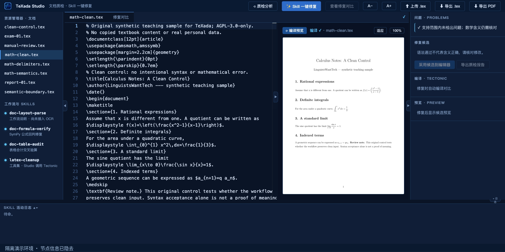

# TeXada Studio User Manual

[中文用户手册](README.md) · [Download Latest v0.1.4](https://github.com/CacinieP/TeXada-Studio-with-agentskills/releases/latest) · [Changelog & Releases](docs/changelog/README.md) · [Troubleshooting](docs/troubleshooting.md) · [System Architecture](docs/architecture/README.md) · [Documentation Index](docs/index.md)

**TeXada Studio** is a **local, privacy-first LaTeX writing, image/PDF import, and AI-assisted review workspace** that runs entirely on your own computer.

It brings together LaTeX editing, offline CJK-ready PDF compilation and preview, formula/table/cleanup diagnostics, and side-by-side repair review in a single window. Your documents, builds, and local AI inference stay on your machine—**no cloud account, no internet requirement, and no external data uploads**.



---

## Quick Installation & Launch

For everyday writing, download the official **self-contained desktop release**. It already bundles the offline LaTeX compiler (`tectonic` with 30+ common packages and Fandol CJK fonts), PDF page renderer (`poppler` with CJK character maps), and the local model engine (`llama-server`)—**no TeX Live, Homebrew, or Python setup required**.

### macOS Desktop App (Apple Silicon, macOS 15+)

1. Download **`TeXada-Studio-macOS-arm64.dmg`** (Developer ID signed & Apple notarized) from [GitHub Releases](https://github.com/CacinieP/TeXada-Studio-with-agentskills/releases/latest).
2. Open the `.dmg` disk image and drag **TeXada Studio** into your **Applications** folder.
3. Launch **TeXada Studio** from Applications or Launchpad.

### Windows Desktop App (64-bit Windows 10 / 11)

1. Download **`TeXada-Studio-Windows-x64.zip`** from [GitHub Releases](https://github.com/CacinieP/TeXada-Studio-with-agentskills/releases/latest).
2. Extract the entire ZIP archive to any folder.
3. Open the extracted folder and double-click **`TeXada Studio.exe`**.

<details>
<summary><strong>Advanced: Run from Source in Your Browser (Linux or Developers)</strong></summary>

Requires Python 3.11+ (install `tectonic` and `poppler` optionally if you need offline PDF previews):

```bash
git clone https://github.com/CacinieP/TeXada-Studio-with-agentskills.git
cd TeXada-Studio-with-agentskills
python3 -m venv .venv && .venv/bin/python -m pip install -r webui/requirements.txt
./scripts/start-local-studio.command   # On Windows: scripts\start-local-studio.bat
```

See the [Local Deployment & Developer Guide](docs/local-studio.md) (Chinese) for CLI flags, offline TeX cache preparation, and test suites.
</details>

---

## What Works Out of the Box vs. With a Local AI Model

The installer does not bundle multi-gigabyte model weights, so **you can write, check, and compile PDFs immediately after installation**. Whenever you want OCR import or model-assisted repairs, you can download a lightweight local model in one click inside Settings:

| Capability | Without AI Model (Immediate) | With Local AI Model Enabled |
| --- | --- | --- |
| **LaTeX Editing & Templates** | 5 built-in offline templates, 82 math/theorem snippets, structure folding & syntax highlighting | Same |
| **Offline PDF Preview** | Multi-page CJK & English PDF compilation, Fit/100% zoom, click compile errors to jump to source line | Same |
| **Formula & Delimiter Checks** | Detects unclosed delimiters, duplicate scripts, and matrix/`cases` shape errors; deterministically repairs unambiguous missing delimiters | Proposes guarded repairs for ambiguous or incomplete formula syntax |
| **Table Total Auditing** | Deterministically recomputes scalar final-row totals (`合计` / `总计` / `total`) in simple `tabular` tables | Completes short or blank final total rows under strict row-preservation guards |
| **Document Format Cleanup** | Strips invisible zero-width characters pasted into prose | Proposes conservative closures for unclosed commands and prose environments (`itemize`, `center`, etc.) |
| **Image & PDF OCR Import** | Requires a local vision model | Transcribes lecture photos, screenshots, or scanned PDFs page-by-page into LaTeX drafts |

---

## Workspace Tour

The Studio window is organized into five clean areas:

1. **Left Activity Bar & Sidebar**: Switch between **Documents** and **Section Outline**, create documents from templates, upload `.tex` files, or launch **Image/PDF Import**. Your personal documents appear at the top, while built-in practice files are tucked inside the collapsible **Samples** group.
2. **Top Toolbar**: Shows the active filename and save status alongside **Save**, **Check**, **Repair** (Agent drawer), **Compile**, **Export**, **Command Palette**, and **Settings**.
3. **Center Editor & Diff Review**: Provides the local Monaco editor during writing, and automatically opens a side-by-side **Repair Diff** tab whenever repair candidates are ready for inspection.
4. **Right PDF Preview**: Displays rendered PDF pages with page navigation and Fit-to-Width / 100% zoom controls. Editing source text immediately marks old previews stale so outdated PDFs are never exported by mistake.
5. **Bottom Diagnostics/Logs & Status Bar**: Stays collapsed until needed; click any problem or compiler error to jump straight to its source line. The status bar displays cursor coordinates and live local model connectivity.

---

## Core Workflows

### 4.1 Create, Open & Save Documents

- **New from Template**: Click **New from Template** in the sidebar (or press `⇧⌘P` / `Ctrl+Shift+P` to open the Command Palette) to choose from five offline templates: **Blank Chinese Article**, **Lecture Notes**, **Exam Paper**, **Beamer Slides**, or **English Article**.
- **Import `.tex` Files**: Click the upload button in the sidebar to import an existing `.tex` file (up to 2 MiB).
- **Safe Saving**: Press `⌘S` (`Ctrl+S` on Windows/Linux) to save. Saving edits to a built-in sample creates your own personal copy without altering the original sample, and closing the app with unsaved changes prompts for confirmation.

### 4.2 Offline PDF Compilation & Export

1. Click **Compile** in the top toolbar to build and preview your multi-page PDF completely offline.
2. If LaTeX reports an error, the bottom log highlights the exact line number—**click the diagnostic to jump directly to that line**.
3. Open the **Export** menu to save your `.tex` source, the verified `.pdf` matching your current text, or a structured `.audit.md` quality report.

### 4.3 Image & PDF OCR Import

To turn photographed notes, formula screenshots, or scanned PDFs into editable LaTeX (with a local vision model running):

1. Click the **Import Image/PDF** icon on the left activity bar and choose a `PNG`, `JPEG`, `WebP`, or `PDF` file (up to 12 MiB).
2. For PDFs, pick the **start page** and batch size (1, 3, or 5 pages per batch).
3. Review the transcription in the **Import Review Dialog**:
   - Edit the recognized LaTeX directly while comparing against your source;
   - Exclude unwanted pages, merge pages into one document, or **split into one `.tex` document per page**;
   - Click **Continue Remaining Pages** on longer PDFs to process the next batch seamlessly.

### 4.4 Guarded Checks & Side-by-Side Repair Review

TeXada Studio never overwrites your manuscript behind your back—every repair follows **Check → Side-by-Side Diff → Explicit Adoption**:

1. **Inspect Only (`Check`)**: Scans inline formulas, matrices/`cases`, simple table totals, and invisible cleanup issues without changing a single character.
2. **Generate Candidates (`Repair`)**: Applies zero-call deterministic fixes first, calls your local model only where needed, blocks any candidate that alters numbers, variables, operators, or prose meaning, and test-compiles the resulting candidate.
3. **Review & Undo Freely**: Inspect every highlighted change in the **Repair Diff** tab. Click **Adopt Candidate** to apply it to the editor or **Reject Candidate** to keep your original text. Even after adopting, you can press **`⌘Z` / `Ctrl+Z`** to undo (or `⇧⌘Z` / `Ctrl+Shift+Z` to redo) before saving with `⌘S` / `Ctrl+S`.
4. **Optional Agent Experiments**: Open the right Agent drawer to opt into **Constrained Agent Planning** or **Allowlisted Skill Selection** when desired.

---

## Configuration

Open **Settings** (gear icon in the top bar) to customize editor font size, word wrap, and local AI models.

### 5.1 One-Click Managed Local Models (Recommended)

In **Settings → Local Model**, select a model profile matching your machine's memory and click **Download & Start** (downloads are resumable, SHA-256 verified, and automatically stopped when you quit TeXada Studio):

| Managed Profile | Disk Space | Recommended RAM | Best For |
| --- | --- | --- | --- |
| **MiniCPM-V 4.7 1B (`Q4_K_M`)** | ~**1.8 GB** | **16 GB+** | **Recommended for most laptops & desktops**: fast download, responsive OCR and formula/table/cleanup repairs |
| **MiniCPM-V 4.7 35B-A3B (`Q4_K_M`)** | ~**22.3 GB** | **64 GB+** | High-memory workstations handling dense page transcriptions and complex repairs |

### 5.2 Connect an Existing Local Ollama or llama.cpp Server

If you already run Ollama or `llama-server` locally, enter its loopback URL (for example `http://127.0.0.1:11434/v1` or `http://127.0.0.1:18147/v1`) and model name in **Settings → Local Model**, click **Check Connection**, and click **Save Settings**. Only `127.0.0.1` / `localhost` loopback endpoints are accepted; cloud URLs are rejected by design.

### 5.3 Where Are My Documents Stored?

All documents, automatic history backups, and downloaded models live in your standard OS user data directory and persist across app upgrades:

| Operating System | Default User Data Directory |
| --- | --- |
| **macOS** | `~/Library/Application Support/TeXada Studio` |
| **Windows** | `%LOCALAPPDATA%\TeXada Studio` |
| **Linux** | `~/.local/share/texada-studio` (or `$XDG_DATA_HOME/texada-studio`) |

Your `.tex` files live in `documents/`, with automatic version snapshots in `documents/.history/` and deleted copies in `documents/.trash/`.

---

## Keyboard Shortcuts

| Action | macOS | Windows / Linux |
| --- | --- | --- |
| Save document | `⌘S` | `Ctrl+S` |
| Undo edit or adopted repair | `⌘Z` | `Ctrl+Z` |
| Redo | `⇧⌘Z` or `⌘Y` | `Ctrl+Shift+Z` or `Ctrl+Y` |
| Command Palette (templates, outline jump, actions) | `⇧⌘P` | `Ctrl+Shift+P` |
| Find in document | `⌘F` | `Ctrl+F` |
| Find and replace | `⌥⌘F` | `Ctrl+H` |
| Navigate & confirm modal lists | `↑` / `↓`, `Enter`, `Esc` | `↑` / `↓`, `Enter`, `Esc` |

---

## Important Notes & FAQ

- **Human Review Remains Essential**: Passing syntax checks or PDF compilation means the LaTeX structure is valid—**not** that a mathematical identity is true (e.g., `1+1=3` compiles cleanly) or that an OCR transcription is error-free. Always verify symbols and data against your original source.
- **Single-File Scope & Bundled Packages**: Studio edits and compiles single `.tex` files offline with 30+ pre-warmed packages (`ctex`, `amsmath`, `amsthm`, `mathtools`, `geometry`, `hyperref`, `xcolor`, `booktabs`, `tabularx`, `multirow`, `enumitem`, `listings`, `tikz`, Fandol CJK fonts, etc.). Multi-file projects with external figures or specialized packages should be compiled with a full local TeX distribution after exporting `.tex`.
- **Why does the status bar say `Model: Unchecked`?** That simply means no external connection probe has been run yet in this session; editing, deterministic repairs, and offline PDF compilation work immediately without a model.
- **Why wasn't `$a_$` filled in automatically?** When an operand or subscript is missing, guessing `$a_1$` could silently invent false math. Ambiguous expressions are intentionally preserved for your manual completion.

For detailed troubleshooting, see the [Installation & Usage Troubleshooting Guide](docs/troubleshooting.md) (Chinese).

---

## Documentation & License

- **Guides & CLI**: [Local Deployment Guide](docs/local-studio.md) · [Troubleshooting](docs/troubleshooting.md) · [AgentSkills Guide](docs/agent-skills.md) · [CLI Harness](harness/README.md)
- **Releases & Changelog**: [Release & Changelog Hub](docs/changelog/README.md) · [Full CHANGELOG](docs/changelog/CHANGELOG.md) · [v0.1.4 Release Notes](docs/releases/v0.1.4.md)
- **System Architecture**: [Architecture Overview](docs/architecture/README.md) · [AgentSkills Technical Report](docs/architecture/skills-technical-report.md) · [Constrained Planner](docs/architecture/constrained-planner.md) · [Skill Selection](docs/architecture/skill-selection.md) · [Full Documentation Index](docs/index.md)
- **Governance & Packaging**: [Source Package Verification](docs/source-package.md) · [Contributing](CONTRIBUTING.md) · [Security Policy](SECURITY.md) · [Support](SUPPORT.md)

**Maintainer & License**: Maintained by [CacinieP](https://github.com/CacinieP). Project-authored code, documentation, and synthetic samples are licensed under [AGPL-3.0-only](LICENSE); bundled editor assets, fonts, and tools retain their respective open-source licenses in [THIRD_PARTY_NOTICES.md](THIRD_PARTY_NOTICES.md) and [desktop/licenses-audit.md](desktop/licenses-audit.md).
