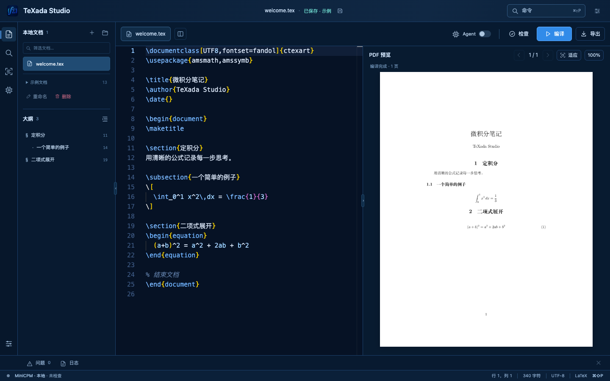

# TeXada Studio 本地版

在自己的电脑上编辑 LaTeX、识别图片或 PDF、检查公式和简单表格。查看修复差异，审阅后保存，再编译和导出。

这是在浏览器中打开的本地工作台。源码、文档与运行记录保存在本机；图片识别和模型候选使用你配置的本机模型服务。

[English](README.en.md) · [开始使用](#开始使用) · [完整指南](docs/local-studio.md) · [AgentSkills](docs/agent-skills.md) · [文档导航](docs/index.md)



当前界面截图，使用仓库自带的合成 `welcome.tex` 示例；2026-11-04。

当前面向本地单用户，仍是开发候选，尚无本次正式 Release。已验证范围见[当前验证记录](docs/current-validation.md)，历史录屏和模型实验保留各自日期与版本。

## 这版可以做什么

| 工作 | 操作 |
| --- | --- |
| 管理文档 | 导入或新建 `.tex`，保存、重命名、删除；已保存的修改在刷新后保留 |
| 识别资料 | 导入 PNG、JPEG、WebP 或 PDF，每次最多识别 5 页；审阅 LaTeX 候选后新建文档 |
| 编辑与检查 | LaTeX 高亮、常用片段与符号补全、五类文档模板、查找替换、文档大纲、命令面板；检查公式语法及简单合计 |
| 修复与审阅 | 先做保留原文的确定性语法修复；模型候选经过语法和修改范围校验，查看 diff 后明确采用或拒绝 |
| 预览与交付 | 编译当前文档，逐页预览并导出 PDF；也可导出 `.tex` 和质检报告 |
| 连接本机模型 | 保存本地服务地址与模型名称，显式检查连接；不会自动改用云模型 |

保存会检查文件版本，发现其他窗口已修改时停止覆盖。编辑内容变化后，旧 PDF 导出会失效，需要重新编译。示例原文件保留在仓库中，保存时建立本地副本。

左侧活动栏可展开文档导航、搜索、图片/PDF 识别和 Agent。点击“检查”查看底部问题列表；从 Agent 中生成和审阅修复候选。底部“问题”“日志”和右侧 Agent 可随时收起，“导出”菜单提供当前 LaTeX 和已编译 PDF。

## 开始使用

需要 **Python 3.11+**。下面以已安装的 `python3.13` 为例，也可替换为其他满足要求的版本：

```bash
git clone https://github.com/CacinieP/TeXada-Studio-with-agentskills.git
cd TeXada-Studio-with-agentskills
python3.13 -m venv .venv
.venv/bin/python -m pip install -r webui/requirements.txt
.venv/bin/python scripts/run-local-studio.py --check
```

macOS 可双击 `scripts/start-local-studio.command`，或在项目目录运行：

```bash
./scripts/start-local-studio.command
```

启动器打开本机浏览器，文档和模型处理都在本地。连接信息保存在用户数据目录；私密浏览器入口写入权限受限的 `session.json`，不会打印访问凭据。按启动终端中的 `Ctrl+C` 停止。

首次安装 Python 依赖、模型、字体和 TeX 资源需要事先准备。Studio 编译使用已缓存的 TeX 资源，不会在文档处理过程中悄悄补下载；尚未准备缓存的电脑会显示缺失资源提示。完整步骤见[本地使用指南](docs/local-studio.md#首次准备与离线使用)。

可用 `.venv/bin/python scripts/prepare-local-tex.py` 离线检查固定样本的 TeX 资源；需要时显式加 `--download-resources` 完成首次准备，再重新离线检查。

Monaco 编辑器资源已随源码提供，无需前端构建。源码包与校验方法见[源码打包](docs/source-package.md)；源码 ZIP 需要自行准备 Python 和所需的可选工具。

| 想使用的功能 | 还需准备 |
| --- | --- |
| 编辑、语法检查、简单表格检查 | 上述 Python 依赖；Monaco 资源已随源码提供 |
| 模型候选与图片识别 | 本机 MiniCPM-V 4.7 1B 服务；自动启动还需 `llama-server`、GGUF 和 projector；确定性语法候选不需要模型 |
| PDF 导入 | Poppler 的 `pdfinfo`、`pdftoppm` |
| PDF 编译与预览 | Tectonic、Poppler 和文档所需的 TeX 缓存、字体 |

有现成模型服务时，可明确指定地址启动：

```bash
.venv/bin/python scripts/run-local-studio.py \
  --base-url http://127.0.0.1:18081/v1 \
  --model MiniCPM-V-4.7-1B --no-auto-model
```

本地模式仅接受 `http://localhost`、`127.0.0.1` 或 `[::1]`，无需 API Key。启动器可复用已有服务；自行启动模型时，退出只停止它自己启动的进程。模型下载与可选路径参数见[连接说明](docs/local-studio.md#本机模型连接)。

## 第一份文档

1. 打开 `welcome.tex` 或 `math-clean.tex`，点击“检查”；编译依赖就绪后点击“编译”。
2. 打开 `math-delimiters.tex`，生成修复候选，查看 diff 后决定是否采用；采用后点击“保存”。
3. 刷新页面，确认保存内容仍在，再导出当前版本的 `.tex` 或 PDF。
4. 选择自己有权使用的图片或 PDF，点击“开始识别”；对照原件审阅识别结果，再新建文档。

“保存”或 `⌘/Ctrl+S` 才会把编辑内容写入本地文档。识别结果和修复候选都不会自动覆盖原文。

公式修复参考 Math Agent 的保真策略：先补可确定的分组或定界符，再用同一检查器验证；候选不能改数字、变量、运算符或删项。缺少操作数、未知宏和解析器不支持的记号保留人工核对。方法、对照样例与验证边界见[公式修复质量记录](docs/formula-repair-quality.md)。

用顶栏“命令”或 `⌘/Ctrl+Shift+P` 查找操作；侧栏大纲可跳转到章节。查找与替换使用编辑器自带面板，外观菜单可以调整字号、自动换行和小地图，设置会在本机保留。LaTeX 常用命令、定理类环境与希腊字母等符号提供本地片段建议，也可按 `Ctrl+Space` 主动唤出；章节命令、导言区定义与交叉引用键分级着色，结构模块一眼可辨；侧栏“从模板新建”可按空白文章、数学讲义、试卷、Beamer 演示与英文文章五类骨架创建文档。状态栏显示光标行列、选区和文档字数。

## 检查范围

TeX 提取器会跳过注释、常见原样环境和命令定义，识别 `$...$`、`$$...$$`、`\(...\)`、`\[...\]` 与 `equation` 等环境。复杂对齐、未知宏和不支持的表达式保留人工检查，不会强行拆成可自动修改的公式。

语法、编译、转写忠实度和数学结论是不同判断。`∫₀¹ x dx = 1` 可以通过语法与编译检查，正确值仍是 `1/2`。OCR、修复候选和表格提示需要结合原文复核。

当前工作单位是单个 `.tex`。多文件 TeX 工程与多人协作未纳入本地版范围；见[路线图](docs/roadmap.md)。

## 示例、验证与开发

无需模型的 CLI 样本、完整测试命令和研究协议见[本地指南](docs/local-studio.md#开发与复现)。主要入口：

- [Studio 操作 Skill](skills/texada-studio/SKILL.md)、[AgentSkills 使用指南](docs/agent-skills.md)：工作区操作、公式/表格、OCR 输入与审阅边界。
- [当前验证](docs/current-validation.md)、[源码打包](docs/source-package.md)、[架构](docs/architecture.md)、[CLI Harness](harness/README.md)。

- [案例手册](docs/casebook.md)、[历史验证记录](docs/validation.md)、[Skill 对照实验](docs/skills-pilot-analysis.md)。
- [Skill 设计与技术报告](docs/skills-technical-report.md)、[受限规划](docs/studio-constrained-planner.md)、[Skill 选择](docs/studio-skill-selection.md)、[单公式交接](docs/studio-formula-handoff.md)。
- [TeXada 系列](docs/texada-series.md)与 [Math Agent](https://github.com/CacinieP/TeXada-the-Math-Agent)：公式输入与文档审阅互补。
- 旧版演示：[视频](https://www.bilibili.com/video/BV16Kan6rEGv/)、[录制证据](docs/dynamic-demo.md)、[公众号文章](https://mp.weixin.qq.com/s/kDkmQp12pBSPkqw2UpeLXw)、[项目报告](docs/project-report.md)。这些材料记录各自日期的版本。

旧 `run-minicpm-v47-studio.sh` 是显式选择的云 API 入口，见[兼容说明](docs/local-studio.md#旧云-api-入口与实验功能)，不要将其结果当作本地推理验收。

原创代码、文档和合成样本采用 **AGPL-3.0-only**；第三方组件保留各自归属，见 [LICENSE](LICENSE)、[THIRD_PARTY_NOTICES.md](THIRD_PARTY_NOTICES.md) 和 [Active Calculus 来源声明](samples/research/ACTIVE_CALCULUS_NOTICE.md)。参与开发见 [CONTRIBUTING.md](CONTRIBUTING.md)，求助见 [SUPPORT.md](SUPPORT.md)。

维护者 [@CacinieP](https://github.com/CacinieP)。引用信息见 [CITATION.cff](CITATION.cff)。
