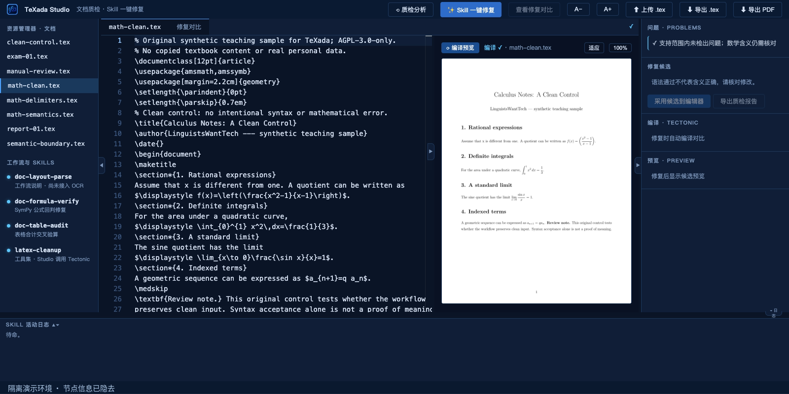

# TeXada Studio 用户手册

[English Manual](README.en.md) · [下载最新版 v0.1.4](https://github.com/CacinieP/TeXada-Studio-with-agentskills/releases/latest) · [版本变更记录](docs/changelog/README.md) · [排错指南](docs/troubleshooting.md) · [系统架构](docs/architecture/README.md) · [全部文档](docs/index.md)

**TeXada Studio** 是一款完全运行在你自己电脑上的 **本地 LaTeX 写作、图片/PDF 识别导入与智能审阅工作台**。

它将 LaTeX 源码编辑、离线中文 PDF 编译预览、公式与表格语法检查、左右对比审阅修复整合在同一个窗口中。所有文稿、编译过程与本地 AI 模型推理均留在你的电脑上，**无需联网、不上传任何云端服务器**。



---

## 快速安装与启动

普通用户推荐直接下载官方打包好的**自包含桌面版**——软件内部已自带离线 LaTeX 编译器（Tectonic 与 30 余个常用宏包、Fandol 中文字体）、PDF 渲染工具与本地模型运行引擎，**无需提前安装 TeX Live、Homebrew 或 Python 环境**。

### 1. macOS 桌面版（Apple Silicon，macOS 15 及以上）

1. 前往 [GitHub Releases](https://github.com/CacinieP/TeXada-Studio-with-agentskills/releases/latest) 下载 **`TeXada-Studio-macOS-arm64.dmg`**（已通过 Apple 公证签名）。
2. 双击打开 `.dmg` 镜像，将 **TeXada Studio** 拖入右侧的 **Applications（应用程序）** 文件夹。
3. 在「应用程序」或启动台中双击 **TeXada Studio** 即可开始写作。

### 2. Windows 桌面版（64 位 Windows 10 / 11）

1. 前往 [GitHub Releases](https://github.com/CacinieP/TeXada-Studio-with-agentskills/releases/latest) 下载 **`TeXada-Studio-Windows-x64.zip`**。
2. 将压缩包完整解压到任意目录（请勿直接在压缩包预览窗口内双击运行）。
3. 打开解压后的文件夹，双击 **`TeXada Studio.exe`** 即可启动。

<details>
<summary><strong>进阶方式：从源码在浏览器中运行（适合 Linux 用户或开发者）</strong></summary>

需要 Python 3.11+；如需离线 PDF 编译预览，可按需安装 `tectonic` 与 `poppler`：

```bash
git clone https://github.com/CacinieP/TeXada-Studio-with-agentskills.git
cd TeXada-Studio-with-agentskills
python3 -m venv .venv && .venv/bin/python -m pip install -r webui/requirements.txt
./scripts/start-local-studio.command   # Windows 可双击 scripts\start-local-studio.bat
```

完整的源码环境准备、离线缓存预热与命令行说明见 [本地部署与开发指南](docs/local-studio.md)。
</details>

---

## 功能一览：不装模型 vs 开启本地模型

安装包默认不捆绑体积较大的 AI 模型文件，**装好软件立刻就能写稿、检查和编译 PDF**；需要识图或复杂修复时，可在软件内一键下载轻量本地模型：

| 使用场景 | 不安装 AI 模型（开箱即用） | 开启本地 AI 模型后 |
| --- | --- | --- |
| **LaTeX 编辑与模板** | 5 套内置模板、82 条数学/定理代码片段、章节折叠与语法高亮 | 同左 |
| **离线中文 PDF 预览** | 一键编译多页中文 PDF、适应窗口/100% 缩放、报错点击跳回源码行 | 同左 |
| **公式与括号检查** | 自动定位未闭合括号、重上下标、矩阵/`cases` 列数异常，并自动修补确定的缺失定界符 | 对规则无法直接修补的残缺公式生成候选修改建议 |
| **表格合计核对** | 自动重算简单三线表末行（`合计` / `总计` / `total`）的数字总和 | 自动补全缺列或留空的表格合计行 |
| **文档格式清洗** | 一键清除混入正文的不可见零宽字符（如复制粘贴带入的隐形符号） | 为未闭合的章节/作者命令及 `itemize` / `center` 等环境提供闭合候选 |
| **图片与 PDF 识别导入** | 需配置视觉模型后可用 | 将讲义照片、截图或扫描 PDF 分页识别为 LaTeX 草稿 |

---

## 工作区界面导览

打开软件后，界面分为五个直观区域：

1. **最左侧活动栏与文件导航**：切换「文档列表」与「章节大纲」，提供 **从模板新建**、**上传 `.tex` 文件**、**图片/PDF 识别导入** 按钮；你的个人文档置顶显示，内置练习样本收纳在下方的「示例文档」折叠区中。
2. **顶部工具栏**：显示当前文档名与保存状态，集中放置 **保存**、**检查**、**修复**（Agent 抽屉）、**编译**、**导出**、**命令面板** 与 **设置** 按钮。
3. **中央源码与审阅区**：日常写作时为本地 Monaco 编辑器；当生成修复建议后，会自动开启 **「修复对比」** 双栏视图，左侧原稿、右侧修改建议逐行对照。
4. **右侧 PDF 预览区**：实时展示编译后的 PDF 页面，支持翻页与「适应窗口 / 100% 原尺寸」切换。只要你改动了左侧源码，旧预览会自动标记为待更新，避免误导出旧版 PDF。
5. **底部问题/日志栏与状态栏**：平时自动收起不占空间；点击问题条目可直接跳转到对应源码行，右下角状态栏随时显示当前行列号与本地模型连接状态。

---

## 日常使用指南

### 1. 新建、打开与保存文稿

- **从模板快速开始**：点击左侧栏的 **「从模板新建」**（或按 `⇧⌘P` / `Ctrl+Shift+P` 打开命令面板），可从 5 套内置离线模板中选择：
  - **空白文章**（中文 `ctexart`，默认配好常用数学宏包与中文字体）
  - **课堂讲义**（预置定理、引理、定义与证明环境）
  - **试卷模板**（含大题、小题与分值排版骨架）
  - **Beamer 演示文稿**（中文学术幻灯片）
  - **英文文章**（标准 `article` 排版）
- **导入已有 `.tex`**：点击左侧栏上传图标选择本机 `.tex` 文件（单文件上限 2 MiB）。
- **安全保存**：按 `⌘S`（Windows `Ctrl+S`）或点击顶栏「保存」。若你打开内置示例文档进行修改，首次保存会自动创建属于你的本地副本，不会破坏原始示例；关闭窗口时若有未保存改动，软件会弹窗提醒。

### 2. 离线编译预览与导出

1. 点击顶栏 **「编译」**，右侧即刻生成并展示 PDF 预览。
2. 若源码存在排版错误，底部日志面板会提取具体的报错行号与原因，**点击报错提示即可直接定位到出错的那一行**。
3. 点击顶栏 **「导出」** 菜单，可将成果保存到电脑任意文件夹：
   - **导出 `.tex` 源码**：保存当前编辑器（或当前审阅候选）的源文件；
   - **导出 `.pdf` 成稿**：保存与当前源码版本一致的最新 PDF；
   - **导出 `.audit.md` 报告**：保存包含检查结果、修改记录与编译摘要的质检报告。

### 3. 图片与 PDF 识别导入（OCR 转 LaTeX）

当你手头有纸质讲义照片、公式截图或扫描版 PDF 想转成可编辑的 LaTeX 时（需先按[配置](#配置)一节启动本地模型）：

1. 点击最左侧活动栏的 **「导入图片/PDF」** 图标，选择本机 `PNG`、`JPEG`、`WebP` 或 `PDF` 文件（不超过 12 MiB）。
2. 若选择 PDF，可指定**起始页码**以及单次识别页数（每次 1、3 或 5 页，避免长文档卡死等待）。
3. 识别完成后会弹出 **识别结果审阅窗**：
   - 你可以对照原件直接在文本框内修正识别文字；
   - 多页 PDF 可勾选排除不需要的页面，并自由选择 **合并为一篇文档** 或 **按页拆分为多篇独立文档**；
   - 若 PDF 还有剩余页，保存当前批次后点击 **「继续识别后续页」** 即可无缝续接下一页。

### 4. 智能检查与修复审阅（不静默篡改原稿）

TeXada Studio 严格遵循 **「先检查 → 生成对比候选 → 你点头才采用」** 的安全流程，绝不会在后台偷偷改写你的正文：

1. **只检查不改稿**：点击顶栏 **「检查」**，底部「问题」面板会列出当前文档中检测到的公式定界符/上下标问题、简单表格合计偏差与隐形格式噪声，点击任意条目即可跳到对应行自行修改。
2. **生成修复建议**：点击顶栏 **「修复」**：
   - 软件会先用确定性规则瞬间修好明确的括号配对、标量合计错误与不可见零宽字符（无需调用模型）；
   - 对剩余问题再请求本地模型，并通过**防篡改守卫**严格拦截任何试图偷改数字、变量、正负号或删减正文项的建议，同时自动测试候选稿能否顺利编译。
3. **左右对比与一键撤销**：
   - 生成建议后自动切换到 **「修复对比」** 标签页，高亮展示每一处增删以及编译是否通过；
   - 确认无误点击 **「采用候选」** 将修改写入编辑器；不满意则点击 **「拒绝候选」** 原封不动保留原稿；
   - 即使点击了「采用候选」，也可随时按 **`⌘Z` / `Ctrl+Z` 一键撤销**（或 `⇧⌘Z` / `Ctrl+Shift+Z` 重做），最后按 `⌘S` / `Ctrl+S` 正式保存。
4. **进阶实验选项（按需开启）**：展开右侧 Agent 面板，可按需勾选默认关闭的「受限 Agent 规划」或「模型选择公式/表格 Skill」，让本机模型在受控步数内自主编排公式、表格与文档清洗技能。

---

## 配置

点击顶栏齿轮图标打开 **「设置」**，即可调整编辑器字号、自动换行以及配置本地 AI 模型。

### 1. 一键下载并启动内置本地模型（推荐）

打开 **「设置 → 本地模型」**，在「Studio 管理的本地模型」下拉框中按电脑内存选择一款型号，点击 **「下载并启动」** 即可（支持断点续传与自动完整性校验，软件退出时自动关闭后台模型）：

| 模型档位 | 占用磁盘空间 | 推荐电脑内存 | 适用建议 |
| --- | --- | --- | --- |
| **MiniCPM-V 4.7 1B（Q4_K_M 轻量版）** | 约 **1.8 GB** | **16 GB 及以上** | **推荐大多数日常电脑使用**：下载快、响应轻快，支持图片/PDF 识别与公式/表格/文档清洗全套流程 |
| **MiniCPM-V 4.7 35B-A3B（Q4_K_M 旗舰版）** | 约 **22.3 GB** | **64 GB 及以上** | 适合大内存工作站，面对复杂版面转写与长难公式修复时表现更稳健 |

### 2. 连接本机已有的 Ollama 或 llama.cpp 服务

如果你电脑上已经装有 Ollama 或自行运行的 `llama-server`，无需重复下载权重，直接在「本地模型」中填入本机地址与模型名称：

- **服务地址示例**：`http://127.0.0.1:11434/v1`（Ollama）或 `http://127.0.0.1:18147/v1`（`llama-server`）
- **生效步骤**：填写地址与模型名 → 点击 **「检查连接」** 验证可达 → 点击 **「保存设置」** 正式启用。
- **隐私保护限制**：仅允许连接 `127.0.0.1` / `localhost` 本机回环地址，系统会自动拒绝任何外部公网云端地址。

### 3. 文档与数据保存在哪里？

你的文档、历史备份与下载的模型均保存在电脑本地的标准应用数据目录中，升级软件版本不会丢失个人文稿：

| 操作系统 | 默认本地数据目录 |
| --- | --- |
| **macOS** | `~/Library/Application Support/TeXada Studio` |
| **Windows** | `%LOCALAPPDATA%\TeXada Studio` |
| **Linux** | `~/.local/share/texada-studio`（或 `$XDG_DATA_HOME/texada-studio`） |

其中 `documents/` 存放你的全部 `.tex` 文稿，`documents/.history/` 与 `documents/.trash/` 会自动保留历史版本与已删除文稿的本地备份，需要备份迁机时直接拷贝 `documents/` 文件夹即可。

---

## 常用快捷键速查

| 操作 | macOS 快捷键 | Windows / Linux 快捷键 |
| --- | --- | --- |
| 保存当前文档 | `⌘S` | `Ctrl+S` |
| 撤销编辑 / 撤销刚采用的修复候选 | `⌘Z` | `Ctrl+Z` |
| 重做 | `⇧⌘Z` 或 `⌘Y` | `Ctrl+Shift+Z` 或 `Ctrl+Y` |
| 打开命令面板（新建模板、跳转章节等） | `⇧⌘P` | `Ctrl+Shift+P` |
| 在文档中查找 | `⌘F` | `Ctrl+F` |
| 查找并替换 | `⌥⌘F` | `Ctrl+H` |
| 弹窗列表选择与关闭 | `↑` / `↓` 移动，`Enter` 确认，`Esc` 关闭 | `↑` / `↓` 移动，`Enter` 确认，`Esc` 关闭 |

---

## 使用须知与常见问题

### 使用边界提醒

- **人工核对不可替代**：语法检查通过或 PDF 编译成功，仅代表 LaTeX 排版格式合法，**不代表数学公式推导正确或图片识别毫无遗漏**（例如 `1+1=3` 语法完全合法但结论错误；模糊照片中的上下标仍需对照原件核实）。
- **单文件与离线宏包范围**：当前以单个 `.tex` 文件为单位进行编辑与编译。桌面版已内置 `ctex`、`amsmath`、`amsthm`、`mathtools`、`geometry`、`hyperref`、`xcolor`、`booktabs`、`tabularx`、`multirow`、`enumitem`、`listings`、`tikz` 等 30 余个高频宏包与 Fandol 中文字体；若文档依赖外部图片目录或冷门宏包，可导出 `.tex` 后使用本机完整 TeX Live 编译。

### 常见疑问速查

- **问：状态栏显示「模型：未检查」是出错了吗？**
  答：不是报错，仅代表本次打开软件后还没有主动探测外部模型。若使用内置模型，去「设置 → 本地模型」点击启动即可；不启动模型也完全不影响写 LaTeX、做规则检查与离线编译 PDF。
- **问：为什么像 `$a_$` 这样的公式只提示问题，没有自动帮我填上数字？**
  答：因为缺少下标时系统无法凭空猜测你原本想写 `$a_1$` 还是 `$a_n$`。为防止胡乱编造改变数学原意，所有含义不唯一的残缺位置都会保留原样并提醒你手动补全。
- **问：下载安装包后如何校验文件完整性？**
  答：可在终端对同目录下载的校验文件执行 `shasum -a 256 -c checksum.txt`（macOS）或在 PowerShell 执行 `Get-FileHash .\TeXada-Studio-Windows-x64.zip -Algorithm SHA256` 对照 `checksum-windows.txt`。

遇到其他安装、连接或编译问题，请查阅 **[完整安装与使用排错指南](docs/troubleshooting.md)**。

---

## 进阶文档与开源许可

- **使用与部署**：[本地部署与开发指南](docs/local-studio.md) · [安装与使用排错](docs/troubleshooting.md) · [AgentSkills 使用说明](docs/agent-skills.md) · [CLI 批处理手册](harness/README.md)
- **版本与更新**：[版本发布与变更总览](docs/changelog/README.md) · [完整 CHANGELOG](docs/changelog/CHANGELOG.md) · [最新 v0.1.4 发布说明](docs/releases/v0.1.4.md)
- **架构与设计**：[系统架构与设计总览](docs/architecture/README.md) · [AgentSkills 技术设计报告](docs/architecture/skills-technical-report.md) · [受限规划器](docs/architecture/constrained-planner.md) · [多 Skill 选择](docs/architecture/skill-selection.md) · [全部文档总索引](docs/index.md)
- **验证与协作**：[当前验证记录](docs/current-validation.md) · [可复核源码包](docs/source-package.md) · [参与贡献](CONTRIBUTING.md) · [安全策略](SECURITY.md) · [求助支持](SUPPORT.md)

**许可证与维护**：维护者 [CacinieP](https://github.com/CacinieP)。项目原创代码、文档与合成样本采用 [AGPL-3.0-only](LICENSE) 开源许可；本地捆绑的编辑器、字体与工具链保留各自开源许可证，详见 [THIRD_PARTY_NOTICES.md](THIRD_PARTY_NOTICES.md) 与 [桌面端组件许可审计](desktop/licenses-audit.md)。
