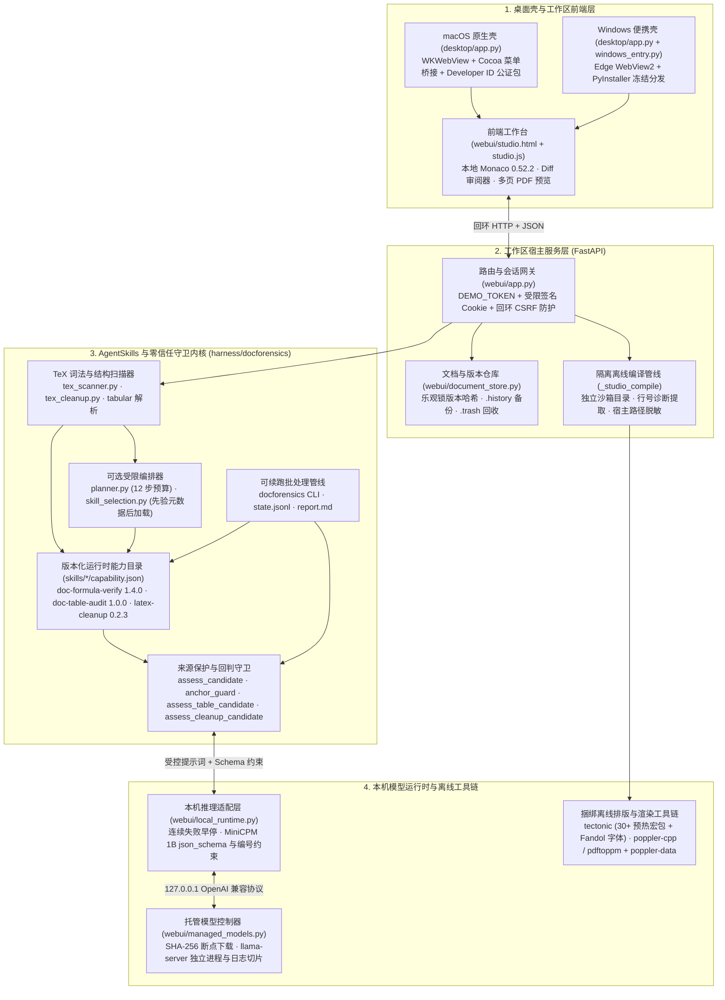
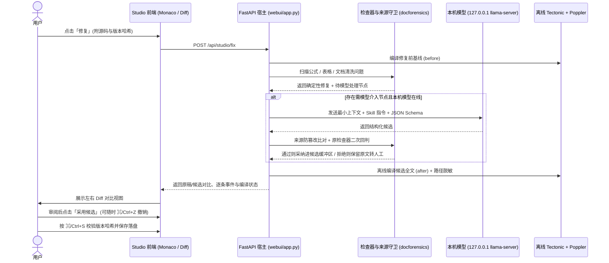

# TeXada Studio 系统架构与设计总览

本文档描述 TeXada Studio（以 `v0.1.4` 为基线）的整体分层架构、核心数据流、安全与来源保护不变量，以及各专题设计文档的导航入口。

- 面向日常写作与安装的操作说明见 **[用户手册（README）](../../README.md)**。
- 命令行参数、环境变量与本地部署细节见 **[本地部署与开发指南](../local-studio.md)**。
- 历次版本演进见 **[版本发布与变更日志总览](../changelog/README.md)**。

---

## 一、核心架构原则

1. **纯本机回环与隐私隔离（Loopback-Only & Offline-First）**
   工作区后端仅监听 `127.0.0.1`，模型客户端（`webui/local_runtime.py`）仅接受本机 HTTP 回环地址（`127.0.0.1` / `localhost` / `::1`），拒绝外部云 API 地址、重定向与环境变量中的系统代理凭据泄漏。离线 PDF 编译强制携带 `tectonic --untrusted --only-cached`，在编辑与编译期间零外网请求。
2. **确定性优先与模型最小介入（Deterministic-First）**
   宿主先运行词法扫描与确定性检查器：成对定界符/花括号闭合、简单三线表标量合计重算、非保护区零宽字符（`\ufeff` / `\u200b` / `\u200c` / `\u200d`）剥离均在本地确定性完成，**零模型请求**。仅当确定性规则无法唯一消歧时，才向本机模型发起受控文本或视觉请求。
3. **零信任候选回判与来源防篡改（Zero-Trust Source Preservation）**
   模型从不直接改写用户源码或执行工具脚本。任何模型输出必须依次通过严格 JSON Schema 校验、来源范围守卫（`assess_candidate` / `anchor_guard` / `assess_table_candidate` / `assess_cleanup_candidate`）以及原检查器的二次回判；凡篡改数字、变量、运算符、正文措辞或破坏闭合顺序的候选一律在宿主层拦截并转交人工核对。
4. **版本绑定与可逆人工审阅（Revision-Bound Human Review）**
   所有修复候选与编译预览均绑定源码内容 SHA-256 与编辑器版本号。用户必须在左右 Diff 视图中显式点击「采用候选」才会更新编辑器缓冲区，且支持单步 `⌘/Ctrl+Z` 撤销与 `⌘/Ctrl+⇧+Z` 重做；源码一旦变动，过期候选与旧版 PDF 立即失效，杜绝跨版本误覆盖。

---

## 二、系统四层拓扑

---

## 三、分模块架构说明

### 1. 桌面端与前端交互层（`desktop/` & `webui/static/`）

- **双平台自包含桌面端**：
  - **macOS（`desktop/build_bundle.py`）**：基于 `py2app` 冻结 Python 3 运行时、FastAPI 后端、`tectonic`、预热 `tex-cache`、基于 `poppler-cpp` 的渲染器与 `poppler-data` CJK 映射，以及官方 `llama.cpp`（含 Metal `MTL0` 与 BLAS 计算后端）；重写 `@loader_path` 动态库加载路径并通过 Developer ID 签名、Apple 公证装订与 Gatekeeper 校验。内置 `NSTimer` 信号泵与 POSIX 唤醒管道看门狗，保证 `SIGTERM` 有界优雅退出，同时注入原生 `Edit → 撤销 / 重做` 菜单桥接。
  - **Windows（`desktop/build_windows_bundle.py` + `desktop/windows_entry.py`）**：基于 PyInstaller 构建无控制台闪烁（`CREATE_NO_WINDOW`）的便携目录包，集成 Edge WebView2、冻结子进程检查器入口（`--run-python-script`）、`tectonic.exe`、`tex-cache`、Poppler Windows CJK 工具链与 `llama-server.exe`，使用 Win32 进程同步句柄与 Winsock `socketpair` 实现孤儿回收与有界退出。
- **前端工作区（`webui/studio.html` + `webui/static/editor/studio.js`）**：
  - 本地托管固定哈希的 Monaco Editor `0.52.2`（MIT），内置 TeX 分节/导言/交叉引用语义着色、结构化环境与章节折叠、82 条数学与定理片段。
  - 静态资源通过 `_RevalidatingStaticFiles` 下发 `Cache-Control: no-cache`，确保开启持久化 WebView 存储的桌面端在跨版本升级后立即生效新样式与脚本。
  - 编辑状态机维护文档版本、脏标记、撤回栈钩子（`window.TeXadaStudioHistory`）与候选新鲜度：任何正文改动立即销毁过期 `diffEditor` 并失效旧 PDF 预览。

### 2. 工作区宿主与存储层（`webui/app.py` & `webui/document_store.py`）

- **文档持久化与防冲突（`DocumentStore`）**：管理用户数据目录下的 `documents/`，每次保存校验前序内容版本哈希以拦截并发覆盖；历史版本写入 `documents/.history/`，删除移入 `documents/.trash/`；跨平台统一拦截路径穿越、macOS APFS NFD 编码差异以及 Windows NTFS 保留设备名（`CON`、`NUL`、`COM1` 等）。
- **隔离编译与日志脱敏（`_studio_compile`）**：每次编译在独立的 `builds/<doc>-<uuid>/` 沙箱内执行离线 `tectonic`，先解析 `main.tex` 错误行号供前端一键跳转，随后由 `_redact_build_paths` 剥离宿主机内部目录前缀，再由 `pdftoppm` 渲染多页 PNG 预览并绑定构建 ID。

### 3. AgentSkills 与零信任守卫内核（`harness/docforensics/` & `skills/`）

运行时目录仅允许加载以下三个带语义版本与 `capability.json` 契约的技能包：

| 技能 ID | 版本 | 检查器与扫描入口 | 修复路径与零信任守卫 |
| --- | --- | --- | --- |
| `doc-formula-verify` | `1.4.0` | `tex_scanner.py` 提取行内 `$...$`、矩阵与 `cases`；`verify.py` 执行词法配对与 SymPy 严格解析 | 先走确定性定界符/花括号闭合；未决 `RETRY` 请求 `vlm.repair_formula`，经 `assess_candidate` + `anchor_guard` 拦截改数、改号、拆字面量与越界算符漂移，再经 `verify.py` 回判 |
| `doc-table-audit` | `1.0.0` | Studio `_table_problems` 与 CLI `audit_table.py`（动态 Decimal 精度核验末行 `合计`/`总计`/`total`） | 标量合计错误直接由宿主 Decimal 确定性重算（0 模型调用）；缺列或空白合计行调用 `vlm.repair_table`，经 `assess_table_candidate` 锁定表头与数据行不可变并由 `audit_table.py` 二次回判 |
| `latex-cleanup` | `0.2.3` | `tex_cleanup.py:inspect_tex_cleanup`（隔离注释、代码与数学区，检测零宽噪声、未闭合命令与正文环境） | 先由 `strip_zero_width_candidate` 确定性剥离零宽字符并由 `assess_zero_width_cleanup` 保底保留；结构缺口请求 `vlm.repair_cleanup`，经 `assess_cleanup_candidate` 验证仅做允许的闭合插入且复检清零 |

此外仓库还包含供 CLI 与外部协作使用的技能包：`doc-ocr-extract`（行级 OCR 提取与复核信号）、`doc-layout-parse`、`doc-report` 与 `texada-studio`（回环 API 操作说明）。

### 4. 本机模型管理与 MiniCPM 1B 结构化约束（`webui/managed_models.py` & `webui/local_runtime.py`）

- **按需权重管理**：内置 `1b`（`MiniCPM-V-4_7-1B-Q4_K_M.gguf` + `mmproj-model-f16.gguf`，约 1.8 GB）与 `35b`（`MiniCPM-V-4_7-35B-A3B-Q4_K_M.gguf` + 视觉投影，约 22.3 GB）两套官方配置，支持断点续传、SHA-256 严格校验、环境变量脱敏启动与退出自动回收；启动失败时仅截取当次启动新增的 `model-server.log` 尾部错误，避免误报旧日志。
- **探活降级与中断早停**：任务开始前先探测配置模型是否在线，缺失时记录「模型服务不可用」并平滑降级为纯确定性修复；任务中途若连续两次发生网络/HTTP 传输失败，立即触发 `PROVIDER_ABORTED` / `PLANNER_ABORTED` 早停，保留已完成及后续确定性修复并输出脱敏诊断，避免空耗 12 次预算。
- **轻量 1B 模型定向加固**：针对 `minicpm-v4.7-1b-q4_k_m`（含内置托管与外部复用实例），`local_runtime.py` 在推理层挂载严格 `json_schema`：
  - Skill 动态选择采用编号枚举（`select_skill_choice`），杜绝小模型跨节点类型误选技能；
  - 表格补全与文档清洗强制 JSON Schema 结构输出，对多处未闭合命令/嵌套正文环境采用逐缺口有界闭合选项（`studio_cleanup_choices`，严格遵循同位嵌套「内先外后」闭合顺序），解决 1B 全文重写遗漏文档尾部的问题，最终仍交由宿主全量零信任守卫裁决。

---

## 四、核心业务数据流

---

## 五、本地数据目录与安全边界

Studio 运行数据默认存放在仓库外的操作系统标准用户目录（可通过 `--state-dir` 或 `TEXADA_STUDIO_STATE_DIR` 覆盖）：

- **macOS**：`~/Library/Application Support/TeXada Studio`
- **Windows**：`%LOCALAPPDATA%\TeXada Studio`
- **Linux**：`$XDG_DATA_HOME/texada-studio`（默认 `~/.local/share/texada-studio`）

目录内职责划分：

| 子路径 | 权限与用途 |
| --- | --- |
| `documents/` | 用户 `.tex` 文档，含 `.history/` 历史快照与 `.trash/` 删除备份 |
| `models/1b/`、`models/35b/` | 按需下载并经 SHA-256 校验的本地 GGUF 权重与视觉投影 |
| `jobs/<job_id>/` | 每次检查/修复任务的事件轨迹、候选绑定与编译摘要 |
| `imports/<import_id>/` | 图片/PDF 识别原件副本、分页渲染与待审转写草稿 |
| `builds/<doc>-<id>/` | 单次离线编译隔离沙箱（错误行提取后路径自动脱敏） |
| `session.json` / `local-runtime.json` | `0o600` 私密会话入口凭据与本机回环模型连接配置 |

源码归档包（`scripts/package.sh`）通过白名单与二进制魔数扫描，严格排除任何运行状态、模型权重、原生可执行文件与私密会话凭据。当前全仓由 **826 项 Python 单元测试**、**4 套 Node.js 前端与清洗测试** 及 **27 项公式检查器契约案例** 持续守护。

---

## 六、架构与设计专题文档索引

本目录下的专题文档记录各子系统的详细协议契约、状态机边界与阶段设计：

| 专题文档 | 涵盖内容 |
| --- | --- |
| **[AgentSkills 技术设计报告](skills-technical-report.md)** | Skill 目录结构、四态检查器返回码（`OK` / `RETRY` / `NEEDS_HUMAN` / `NEEDS_ENV`）、CLI `state.jsonl` 断点续跑键与扩展规范 |
| **[受限 Agent 规划器设计](constrained-planner.md)** | 默认关闭的 `planner_mode` 状态机、12 步/240 秒共享预算、动作掩码与审计事件契约 |
| **[白名单多 Skill 动态选择设计](skill-selection.md)** | 默认关闭的 `skill_selection` 开关、`capability.json` 元数据预检、版本哈希核验与拒绝降级路径 |
| **[单公式 Math Agent 交接协议](formula-handoff.md)** | 可选外部单公式交接接口、Unicode 码点偏移转换、四元组版本绑定与幂等审阅确认 |
| **[图片与 PDF 识别导入管线设计](ocr-pipeline.md)** | Studio 受保护 `/api/studio/import` 流程与独立 `doc-ocr-extract` 实验管线的职责分界 |
| **[深海蓝视觉工作区交互设计](visual-workspace.md)** | 连续五栏布局、按需展开抽屉、无障碍焦点约束与浏览器验收基线 |
| **[早期项目提案入口](proposal.md)** | 项目立项初期的场景定义与技术报告导引 |
| **[CLI Harness 模块手册](../../harness/README.md)** | `docforensics` 命令行批处理输入格式、退出码与独立运行方式 |
