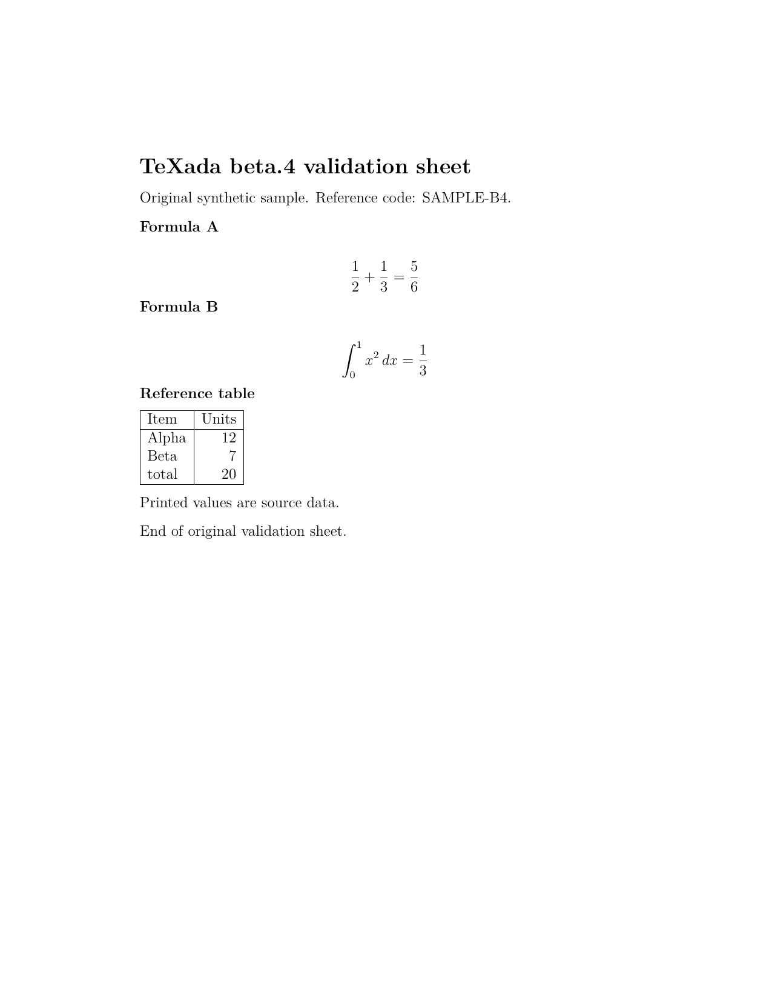

# 质检报告

运行：`b7a4c0e8b9b3498a92246d4b70e1f33b`
提供方：fixture (offline test double)

本报告按本次运行统计；候选通过检查不表示已被使用者采用。

本次模型 HTTP 请求尝试：0
计数包含超时请求，不代表服务端完成推理。

## beta4-source

OK 9 · 待人工 1 · 复用 10 · 未完成 0

### 节点 ocr-0001-0001

检查终态：OK
输入 SHA256：`6eda38446cc4e30553a2d2e312ea86cbe3acca791c059b7c4cd6dd6cb2c07560`
执行上下文 SHA256：`f2065ff6994806e4a638b94f343d75dca2fcc7c42e0cbeec01b89fd44271124f`

输入与执行上下文一致，复用运行 `2f010fe3fd0d459896d44535b90afad0` 的终态；本次未修复此节点。

#### 来源图与区域（操作者标注）

坐标来自操作者标注；范围和来源哈希通过校验不代表区域内容已核验。

[原图](sources/75e07aed9b61c717362a2c76e6059a81cbe4b56919f0cde99e5172704389613e.png) · [带框标注图](sources/482b11d339f8e0c12af482677dcef318843faf354bf98356c39a6502f815a1b6-annotated.svg) · [区域放大图](sources/482b11d339f8e0c12af482677dcef318843faf354bf98356c39a6502f815a1b6-zoom.svg)



```json
{
  "image_sha256": "75e07aed9b61c717362a2c76e6059a81cbe4b56919f0cde99e5172704389613e",
  "bbox": [
    226,
    253,
    783,
    299
  ],
  "coordinate_system": "top_left_pixel_xyxy_half_open",
  "annotation_source": "operator_provided",
  "page": 1,
  "reviewer": "agent-source-comparison-not-independent-human"
}
```

对应 OCR 原文（不是候选修订）：
```text
TeXada beta.4 validation sheet
```

处置原因：
```text
unsupported_node_type_not_checked
```

#### 检查与候选记录

```json
[
  {
    "run_id": "b7a4c0e8b9b3498a92246d4b70e1f33b",
    "doc": "beta4-source",
    "node_id": "ocr-0001-0001",
    "input_sha256": "6eda38446cc4e30553a2d2e312ea86cbe3acca791c059b7c4cd6dd6cb2c07560",
    "context_sha256": "f2065ff6994806e4a638b94f343d75dca2fcc7c42e0cbeec01b89fd44271124f",
    "revision": 0,
    "action": "SOURCE_REGION",
    "source_region": {
      "image_path": "sources/75e07aed9b61c717362a2c76e6059a81cbe4b56919f0cde99e5172704389613e.png",
      "image_sha256": "75e07aed9b61c717362a2c76e6059a81cbe4b56919f0cde99e5172704389613e",
      "width": 1275,
      "height": 1650,
      "bbox": [
        226,
        253,
        783,
        299
      ],
      "coordinate_system": "top_left_pixel_xyxy_half_open",
      "annotation_source": "operator_provided",
      "source_text": [
        "TeXada beta.4 validation sheet"
      ],
      "reviewer": "agent-source-comparison-not-independent-human",
      "page": 1
    },
    "schema_version": 2,
    "ts": "2026-11-11T14:45:34+0800"
  }
]
```

### 节点 ocr-0002-0002

检查终态：OK
输入 SHA256：`95fbc2d02b94520979f1a1f4530c6c2e32f4bb102d32d01ce8654fdcdb269dd6`
执行上下文 SHA256：`f2065ff6994806e4a638b94f343d75dca2fcc7c42e0cbeec01b89fd44271124f`

输入与执行上下文一致，复用运行 `2f010fe3fd0d459896d44535b90afad0` 的终态；本次未修复此节点。

#### 来源图与区域（操作者标注）

坐标来自操作者标注；范围和来源哈希通过校验不代表区域内容已核验。

[原图](sources/75e07aed9b61c717362a2c76e6059a81cbe4b56919f0cde99e5172704389613e.png) · [带框标注图](sources/4a5a471091bbc14beb89d43e1f62960df939faf4b628e4a891f9a1f0a68664ac-annotated.svg) · [区域放大图](sources/4a5a471091bbc14beb89d43e1f62960df939faf4b628e4a891f9a1f0a68664ac-zoom.svg)

```json
{
  "image_sha256": "75e07aed9b61c717362a2c76e6059a81cbe4b56919f0cde99e5172704389613e",
  "bbox": [
    226,
    310,
    849,
    344
  ],
  "coordinate_system": "top_left_pixel_xyxy_half_open",
  "annotation_source": "operator_provided",
  "page": 1,
  "reviewer": "agent-source-comparison-not-independent-human"
}
```

对应 OCR 原文（不是候选修订）：
```text
Original synthetic sample. Reference code: SAMPLE-B4.
```

处置原因：
```text
unsupported_node_type_not_checked
```

#### 检查与候选记录

```json
[
  {
    "run_id": "b7a4c0e8b9b3498a92246d4b70e1f33b",
    "doc": "beta4-source",
    "node_id": "ocr-0002-0002",
    "input_sha256": "95fbc2d02b94520979f1a1f4530c6c2e32f4bb102d32d01ce8654fdcdb269dd6",
    "context_sha256": "f2065ff6994806e4a638b94f343d75dca2fcc7c42e0cbeec01b89fd44271124f",
    "revision": 0,
    "action": "SOURCE_REGION",
    "source_region": {
      "image_path": "sources/75e07aed9b61c717362a2c76e6059a81cbe4b56919f0cde99e5172704389613e.png",
      "image_sha256": "75e07aed9b61c717362a2c76e6059a81cbe4b56919f0cde99e5172704389613e",
      "width": 1275,
      "height": 1650,
      "bbox": [
        226,
        310,
        849,
        344
      ],
      "coordinate_system": "top_left_pixel_xyxy_half_open",
      "annotation_source": "operator_provided",
      "source_text": [
        "Original synthetic sample. Reference code: SAMPLE-B4."
      ],
      "reviewer": "agent-source-comparison-not-independent-human",
      "page": 1
    },
    "schema_version": 2,
    "ts": "2026-11-11T14:45:34+0800"
  }
]
```

### 节点 ocr-0003-0003

检查终态：OK
输入 SHA256：`415335d678277e5626f9c7826d392707a7fd463ec3a034267d0c2661752face4`
执行上下文 SHA256：`f2065ff6994806e4a638b94f343d75dca2fcc7c42e0cbeec01b89fd44271124f`

输入与执行上下文一致，复用运行 `2f010fe3fd0d459896d44535b90afad0` 的终态；本次未修复此节点。

#### 来源图与区域（操作者标注）

坐标来自操作者标注；范围和来源哈希通过校验不代表区域内容已核验。

[原图](sources/75e07aed9b61c717362a2c76e6059a81cbe4b56919f0cde99e5172704389613e.png) · [带框标注图](sources/fe6286222e623a4f195745899a88eda6d20ff9066314e9cec12ebcab29d9a132-annotated.svg) · [区域放大图](sources/fe6286222e623a4f195745899a88eda6d20ff9066314e9cec12ebcab29d9a132-zoom.svg)

```json
{
  "image_sha256": "75e07aed9b61c717362a2c76e6059a81cbe4b56919f0cde99e5172704389613e",
  "bbox": [
    226,
    357,
    366,
    392
  ],
  "coordinate_system": "top_left_pixel_xyxy_half_open",
  "annotation_source": "operator_provided",
  "page": 1,
  "reviewer": "agent-source-comparison-not-independent-human"
}
```

对应 OCR 原文（不是候选修订）：
```text
Formula A
```

处置原因：
```text
unsupported_node_type_not_checked
```

#### 检查与候选记录

```json
[
  {
    "run_id": "b7a4c0e8b9b3498a92246d4b70e1f33b",
    "doc": "beta4-source",
    "node_id": "ocr-0003-0003",
    "input_sha256": "415335d678277e5626f9c7826d392707a7fd463ec3a034267d0c2661752face4",
    "context_sha256": "f2065ff6994806e4a638b94f343d75dca2fcc7c42e0cbeec01b89fd44271124f",
    "revision": 0,
    "action": "SOURCE_REGION",
    "source_region": {
      "image_path": "sources/75e07aed9b61c717362a2c76e6059a81cbe4b56919f0cde99e5172704389613e.png",
      "image_sha256": "75e07aed9b61c717362a2c76e6059a81cbe4b56919f0cde99e5172704389613e",
      "width": 1275,
      "height": 1650,
      "bbox": [
        226,
        357,
        366,
        392
      ],
      "coordinate_system": "top_left_pixel_xyxy_half_open",
      "annotation_source": "operator_provided",
      "source_text": [
        "Formula A"
      ],
      "reviewer": "agent-source-comparison-not-independent-human",
      "page": 1
    },
    "schema_version": 2,
    "ts": "2026-11-11T14:45:34+0800"
  }
]
```

### 节点 ocr-0004-0004

检查终态：OK
输入 SHA256：`5d7cd7c5a0f147b4ec7eca8fa59704d5693947d8f4109b8722d8a8c210123ace`
执行上下文 SHA256：`ddd1a32fcc663a3e2483991f44614718cff8dc491580b49a023987d4e6092f05`

输入与执行上下文一致，复用运行 `2f010fe3fd0d459896d44535b90afad0` 的终态；本次未修复此节点。

#### 来源图与区域（操作者标注）

坐标来自操作者标注；范围和来源哈希通过校验不代表区域内容已核验。

[原图](sources/75e07aed9b61c717362a2c76e6059a81cbe4b56919f0cde99e5172704389613e.png) · [带框标注图](sources/972f5ace0c548515959f477524efb9338d6209f67b52b350992837a9ca62d037-annotated.svg) · [区域放大图](sources/972f5ace0c548515959f477524efb9338d6209f67b52b350992837a9ca62d037-zoom.svg)

```json
{
  "image_sha256": "75e07aed9b61c717362a2c76e6059a81cbe4b56919f0cde99e5172704389613e",
  "bbox": [
    576,
    426,
    695,
    491
  ],
  "coordinate_system": "top_left_pixel_xyxy_half_open",
  "annotation_source": "operator_provided",
  "page": 1,
  "reviewer": "agent-source-comparison-not-independent-human"
}
```

对应 OCR 原文（不是候选修订）：
```text
\(\frac{1}{2} + \frac{1}{3} = \frac{5}{6}\)
```

#### 检查与候选记录

```json
[
  {
    "run_id": "b7a4c0e8b9b3498a92246d4b70e1f33b",
    "doc": "beta4-source",
    "node_id": "ocr-0004-0004",
    "input_sha256": "5d7cd7c5a0f147b4ec7eca8fa59704d5693947d8f4109b8722d8a8c210123ace",
    "context_sha256": "ddd1a32fcc663a3e2483991f44614718cff8dc491580b49a023987d4e6092f05",
    "revision": 0,
    "action": "SOURCE_REGION",
    "source_region": {
      "image_path": "sources/75e07aed9b61c717362a2c76e6059a81cbe4b56919f0cde99e5172704389613e.png",
      "image_sha256": "75e07aed9b61c717362a2c76e6059a81cbe4b56919f0cde99e5172704389613e",
      "width": 1275,
      "height": 1650,
      "bbox": [
        576,
        426,
        695,
        491
      ],
      "coordinate_system": "top_left_pixel_xyxy_half_open",
      "annotation_source": "operator_provided",
      "source_text": [
        "\\(\\frac{1}{2} + \\frac{1}{3} = \\frac{5}{6}\\)"
      ],
      "reviewer": "agent-source-comparison-not-independent-human",
      "page": 1
    },
    "schema_version": 2,
    "ts": "2026-11-11T14:45:34+0800"
  }
]
```

### 节点 ocr-0005-0005

检查终态：OK
输入 SHA256：`0421928b8bcf4e0aad71c7ed442419b634aeb22fa4f6718c91f97c4b9332fb7b`
执行上下文 SHA256：`f2065ff6994806e4a638b94f343d75dca2fcc7c42e0cbeec01b89fd44271124f`

输入与执行上下文一致，复用运行 `2f010fe3fd0d459896d44535b90afad0` 的终态；本次未修复此节点。

#### 来源图与区域（操作者标注）

坐标来自操作者标注；范围和来源哈希通过校验不代表区域内容已核验。

[原图](sources/75e07aed9b61c717362a2c76e6059a81cbe4b56919f0cde99e5172704389613e.png) · [带框标注图](sources/cff0c016f6c92b5304f3b21d6ff3513624baf5c573701e1e55d81654e3e786b0-annotated.svg) · [区域放大图](sources/cff0c016f6c92b5304f3b21d6ff3513624baf5c573701e1e55d81654e3e786b0-zoom.svg)

```json
{
  "image_sha256": "75e07aed9b61c717362a2c76e6059a81cbe4b56919f0cde99e5172704389613e",
  "bbox": [
    226,
    490,
    365,
    524
  ],
  "coordinate_system": "top_left_pixel_xyxy_half_open",
  "annotation_source": "operator_provided",
  "page": 1,
  "reviewer": "agent-source-comparison-not-independent-human"
}
```

对应 OCR 原文（不是候选修订）：
```text
Formula B
```

处置原因：
```text
unsupported_node_type_not_checked
```

#### 检查与候选记录

```json
[
  {
    "run_id": "b7a4c0e8b9b3498a92246d4b70e1f33b",
    "doc": "beta4-source",
    "node_id": "ocr-0005-0005",
    "input_sha256": "0421928b8bcf4e0aad71c7ed442419b634aeb22fa4f6718c91f97c4b9332fb7b",
    "context_sha256": "f2065ff6994806e4a638b94f343d75dca2fcc7c42e0cbeec01b89fd44271124f",
    "revision": 0,
    "action": "SOURCE_REGION",
    "source_region": {
      "image_path": "sources/75e07aed9b61c717362a2c76e6059a81cbe4b56919f0cde99e5172704389613e.png",
      "image_sha256": "75e07aed9b61c717362a2c76e6059a81cbe4b56919f0cde99e5172704389613e",
      "width": 1275,
      "height": 1650,
      "bbox": [
        226,
        490,
        365,
        524
      ],
      "coordinate_system": "top_left_pixel_xyxy_half_open",
      "annotation_source": "operator_provided",
      "source_text": [
        "Formula B"
      ],
      "reviewer": "agent-source-comparison-not-independent-human",
      "page": 1
    },
    "schema_version": 2,
    "ts": "2026-11-11T14:45:34+0800"
  }
]
```

### 节点 ocr-0006-0006

检查终态：OK
输入 SHA256：`25641a3864ce1302aabbc419a4eff611f5afb9fb6541f0ca86e14e5b1cece1b0`
执行上下文 SHA256：`ddd1a32fcc663a3e2483991f44614718cff8dc491580b49a023987d4e6092f05`

输入与执行上下文一致，复用运行 `2f010fe3fd0d459896d44535b90afad0` 的终态；本次未修复此节点。

#### 来源图与区域（操作者标注）

坐标来自操作者标注；范围和来源哈希通过校验不代表区域内容已核验。

[原图](sources/75e07aed9b61c717362a2c76e6059a81cbe4b56919f0cde99e5172704389613e.png) · [带框标注图](sources/d9ed64816e5c537c2284b48b1a86c3365baa8b8e8d3d60625e4a75be3198802d-annotated.svg) · [区域放大图](sources/d9ed64816e5c537c2284b48b1a86c3365baa8b8e8d3d60625e4a75be3198802d-zoom.svg)

```json
{
  "image_sha256": "75e07aed9b61c717362a2c76e6059a81cbe4b56919f0cde99e5172704389613e",
  "bbox": [
    559,
    540,
    709,
    632
  ],
  "coordinate_system": "top_left_pixel_xyxy_half_open",
  "annotation_source": "operator_provided",
  "page": 1,
  "reviewer": "agent-source-comparison-not-independent-human"
}
```

对应 OCR 原文（不是候选修订）：
```text
\(\int_{0}^{1} x^{2} \, dx = \frac{1}{3}\)
```

#### 检查与候选记录

```json
[
  {
    "run_id": "b7a4c0e8b9b3498a92246d4b70e1f33b",
    "doc": "beta4-source",
    "node_id": "ocr-0006-0006",
    "input_sha256": "25641a3864ce1302aabbc419a4eff611f5afb9fb6541f0ca86e14e5b1cece1b0",
    "context_sha256": "ddd1a32fcc663a3e2483991f44614718cff8dc491580b49a023987d4e6092f05",
    "revision": 0,
    "action": "SOURCE_REGION",
    "source_region": {
      "image_path": "sources/75e07aed9b61c717362a2c76e6059a81cbe4b56919f0cde99e5172704389613e.png",
      "image_sha256": "75e07aed9b61c717362a2c76e6059a81cbe4b56919f0cde99e5172704389613e",
      "width": 1275,
      "height": 1650,
      "bbox": [
        559,
        540,
        709,
        632
      ],
      "coordinate_system": "top_left_pixel_xyxy_half_open",
      "annotation_source": "operator_provided",
      "source_text": [
        "\\(\\int_{0}^{1} x^{2} \\, dx = \\frac{1}{3}\\)"
      ],
      "reviewer": "agent-source-comparison-not-independent-human",
      "page": 1
    },
    "schema_version": 2,
    "ts": "2026-11-11T14:45:34+0800"
  }
]
```

### 节点 ocr-0007-0007

检查终态：OK
输入 SHA256：`96e41e9235113e9cf5aaff5c4d46f5a1aca25a8b3f41bb79018b87543fc73415`
执行上下文 SHA256：`f2065ff6994806e4a638b94f343d75dca2fcc7c42e0cbeec01b89fd44271124f`

输入与执行上下文一致，复用运行 `2f010fe3fd0d459896d44535b90afad0` 的终态；本次未修复此节点。

#### 来源图与区域（操作者标注）

坐标来自操作者标注；范围和来源哈希通过校验不代表区域内容已核验。

[原图](sources/75e07aed9b61c717362a2c76e6059a81cbe4b56919f0cde99e5172704389613e.png) · [带框标注图](sources/a430a86e2a7c0f56602eaaaee87077092082d12f3ef5769b87b1711e80bcd936-annotated.svg) · [区域放大图](sources/a430a86e2a7c0f56602eaaaee87077092082d12f3ef5769b87b1711e80bcd936-zoom.svg)

```json
{
  "image_sha256": "75e07aed9b61c717362a2c76e6059a81cbe4b56919f0cde99e5172704389613e",
  "bbox": [
    226,
    633,
    426,
    667
  ],
  "coordinate_system": "top_left_pixel_xyxy_half_open",
  "annotation_source": "operator_provided",
  "page": 1,
  "reviewer": "agent-source-comparison-not-independent-human"
}
```

对应 OCR 原文（不是候选修订）：
```text
Reference table
```

处置原因：
```text
unsupported_node_type_not_checked
```

#### 检查与候选记录

```json
[
  {
    "run_id": "b7a4c0e8b9b3498a92246d4b70e1f33b",
    "doc": "beta4-source",
    "node_id": "ocr-0007-0007",
    "input_sha256": "96e41e9235113e9cf5aaff5c4d46f5a1aca25a8b3f41bb79018b87543fc73415",
    "context_sha256": "f2065ff6994806e4a638b94f343d75dca2fcc7c42e0cbeec01b89fd44271124f",
    "revision": 0,
    "action": "SOURCE_REGION",
    "source_region": {
      "image_path": "sources/75e07aed9b61c717362a2c76e6059a81cbe4b56919f0cde99e5172704389613e.png",
      "image_sha256": "75e07aed9b61c717362a2c76e6059a81cbe4b56919f0cde99e5172704389613e",
      "width": 1275,
      "height": 1650,
      "bbox": [
        226,
        633,
        426,
        667
      ],
      "coordinate_system": "top_left_pixel_xyxy_half_open",
      "annotation_source": "operator_provided",
      "source_text": [
        "Reference table"
      ],
      "reviewer": "agent-source-comparison-not-independent-human",
      "page": 1
    },
    "schema_version": 2,
    "ts": "2026-11-11T14:45:34+0800"
  }
]
```

### 节点 ocr-0008-0011

检查终态：NEEDS_HUMAN
输入 SHA256：`8eb128121ed18b7a19e3ee3f23bbc763132392e5c759307e2a65644fff9af313`
执行上下文 SHA256：`0cecf3c6498f12aa26cf33cec6263c8a3475d2606cd1c3b8348fef1d48434ee8`

输入与执行上下文一致，复用运行 `2f010fe3fd0d459896d44535b90afad0` 的终态；本次未修复此节点。

#### 来源图与区域（操作者标注）

坐标来自操作者标注；范围和来源哈希通过校验不代表区域内容已核验。

[原图](sources/75e07aed9b61c717362a2c76e6059a81cbe4b56919f0cde99e5172704389613e.png) · [带框标注图](sources/43cb6ebeba83493964df734e075e49a667900583ef7807461574aaec2fc5bdcb-annotated.svg) · [区域放大图](sources/43cb6ebeba83493964df734e075e49a667900583ef7807461574aaec2fc5bdcb-zoom.svg)

```json
{
  "image_sha256": "75e07aed9b61c717362a2c76e6059a81cbe4b56919f0cde99e5172704389613e",
  "bbox": [
    226,
    662,
    408,
    812
  ],
  "coordinate_system": "top_left_pixel_xyxy_half_open",
  "annotation_source": "operator_provided",
  "page": 1,
  "reviewer": "agent-source-comparison-not-independent-human"
}
```

对应 OCR 原文（不是候选修订）：
```text
Item|Units
Alpha|12
Beta|7
total|20
```

处置原因：
```text
sum_mismatch
```

提供方结果：
```text
fixture_missing
```

#### 检查与候选记录

```json
[
  {
    "run_id": "b7a4c0e8b9b3498a92246d4b70e1f33b",
    "doc": "beta4-source",
    "node_id": "ocr-0008-0011",
    "input_sha256": "8eb128121ed18b7a19e3ee3f23bbc763132392e5c759307e2a65644fff9af313",
    "context_sha256": "0cecf3c6498f12aa26cf33cec6263c8a3475d2606cd1c3b8348fef1d48434ee8",
    "revision": 0,
    "action": "SOURCE_REGION",
    "source_region": {
      "image_path": "sources/75e07aed9b61c717362a2c76e6059a81cbe4b56919f0cde99e5172704389613e.png",
      "image_sha256": "75e07aed9b61c717362a2c76e6059a81cbe4b56919f0cde99e5172704389613e",
      "width": 1275,
      "height": 1650,
      "bbox": [
        226,
        662,
        408,
        812
      ],
      "coordinate_system": "top_left_pixel_xyxy_half_open",
      "annotation_source": "operator_provided",
      "source_text": [
        "Item|Units",
        "Alpha|12",
        "Beta|7",
        "total|20"
      ],
      "reviewer": "agent-source-comparison-not-independent-human",
      "page": 1
    },
    "schema_version": 2,
    "ts": "2026-11-11T14:45:34+0800"
  }
]
```

### 节点 ocr-0012-0012

检查终态：OK
输入 SHA256：`1c0e37c8e7205cda77b720cbd5f45116903abfc13f9e1d5affd9f4c0974ff0db`
执行上下文 SHA256：`f2065ff6994806e4a638b94f343d75dca2fcc7c42e0cbeec01b89fd44271124f`

输入与执行上下文一致，复用运行 `2f010fe3fd0d459896d44535b90afad0` 的终态；本次未修复此节点。

#### 来源图与区域（操作者标注）

坐标来自操作者标注；范围和来源哈希通过校验不代表区域内容已核验。

[原图](sources/75e07aed9b61c717362a2c76e6059a81cbe4b56919f0cde99e5172704389613e.png) · [带框标注图](sources/7825cb9528f8518573dfe9c6de48ba91c0fab22ba9b3f055bba32b19d41945d4-annotated.svg) · [区域放大图](sources/7825cb9528f8518573dfe9c6de48ba91c0fab22ba9b3f055bba32b19d41945d4-zoom.svg)

```json
{
  "image_sha256": "75e07aed9b61c717362a2c76e6059a81cbe4b56919f0cde99e5172704389613e",
  "bbox": [
    226,
    812,
    565,
    847
  ],
  "coordinate_system": "top_left_pixel_xyxy_half_open",
  "annotation_source": "operator_provided",
  "page": 1,
  "reviewer": "agent-source-comparison-not-independent-human"
}
```

对应 OCR 原文（不是候选修订）：
```text
Printed values are source data.
```

处置原因：
```text
unsupported_node_type_not_checked
```

#### 检查与候选记录

```json
[
  {
    "run_id": "b7a4c0e8b9b3498a92246d4b70e1f33b",
    "doc": "beta4-source",
    "node_id": "ocr-0012-0012",
    "input_sha256": "1c0e37c8e7205cda77b720cbd5f45116903abfc13f9e1d5affd9f4c0974ff0db",
    "context_sha256": "f2065ff6994806e4a638b94f343d75dca2fcc7c42e0cbeec01b89fd44271124f",
    "revision": 0,
    "action": "SOURCE_REGION",
    "source_region": {
      "image_path": "sources/75e07aed9b61c717362a2c76e6059a81cbe4b56919f0cde99e5172704389613e.png",
      "image_sha256": "75e07aed9b61c717362a2c76e6059a81cbe4b56919f0cde99e5172704389613e",
      "width": 1275,
      "height": 1650,
      "bbox": [
        226,
        812,
        565,
        847
      ],
      "coordinate_system": "top_left_pixel_xyxy_half_open",
      "annotation_source": "operator_provided",
      "source_text": [
        "Printed values are source data."
      ],
      "reviewer": "agent-source-comparison-not-independent-human",
      "page": 1
    },
    "schema_version": 2,
    "ts": "2026-11-11T14:45:34+0800"
  }
]
```

### 节点 ocr-0013-0013

检查终态：OK
输入 SHA256：`e209b8ff56edc72b8d552259f787c32eaee9b863f5c00a7dc452bdb8b3828f1e`
执行上下文 SHA256：`f2065ff6994806e4a638b94f343d75dca2fcc7c42e0cbeec01b89fd44271124f`

输入与执行上下文一致，复用运行 `2f010fe3fd0d459896d44535b90afad0` 的终态；本次未修复此节点。

#### 来源图与区域（操作者标注）

坐标来自操作者标注；范围和来源哈希通过校验不代表区域内容已核验。

[原图](sources/75e07aed9b61c717362a2c76e6059a81cbe4b56919f0cde99e5172704389613e.png) · [带框标注图](sources/ef082f2fce3e2d6ee3c971230fedfa73c6edfd60bff23a4003dea4628b01a867-annotated.svg) · [区域放大图](sources/ef082f2fce3e2d6ee3c971230fedfa73c6edfd60bff23a4003dea4628b01a867-zoom.svg)

```json
{
  "image_sha256": "75e07aed9b61c717362a2c76e6059a81cbe4b56919f0cde99e5172704389613e",
  "bbox": [
    226,
    860,
    578,
    894
  ],
  "coordinate_system": "top_left_pixel_xyxy_half_open",
  "annotation_source": "operator_provided",
  "page": 1,
  "reviewer": "agent-source-comparison-not-independent-human"
}
```

对应 OCR 原文（不是候选修订）：
```text
End of original validation sheet.
```

处置原因：
```text
unsupported_node_type_not_checked
```

#### 检查与候选记录

```json
[
  {
    "run_id": "b7a4c0e8b9b3498a92246d4b70e1f33b",
    "doc": "beta4-source",
    "node_id": "ocr-0013-0013",
    "input_sha256": "e209b8ff56edc72b8d552259f787c32eaee9b863f5c00a7dc452bdb8b3828f1e",
    "context_sha256": "f2065ff6994806e4a638b94f343d75dca2fcc7c42e0cbeec01b89fd44271124f",
    "revision": 0,
    "action": "SOURCE_REGION",
    "source_region": {
      "image_path": "sources/75e07aed9b61c717362a2c76e6059a81cbe4b56919f0cde99e5172704389613e.png",
      "image_sha256": "75e07aed9b61c717362a2c76e6059a81cbe4b56919f0cde99e5172704389613e",
      "width": 1275,
      "height": 1650,
      "bbox": [
        226,
        860,
        578,
        894
      ],
      "coordinate_system": "top_left_pixel_xyxy_half_open",
      "annotation_source": "operator_provided",
      "source_text": [
        "End of original validation sheet."
      ],
      "reviewer": "agent-source-comparison-not-independent-human",
      "page": 1
    },
    "schema_version": 2,
    "ts": "2026-11-11T14:45:34+0800"
  }
]
```
