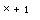

# 质检报告

运行：`bce7a5da88bf433d9f175f59934f8067`
提供方：fixture (offline test double)

本报告按本次运行统计；候选通过检查不表示已被使用者采用。

本次模型 HTTP 请求尝试：0
计数包含超时请求，不代表服务端完成推理。

## source-region-fixture

OK 1 · 待人工 0 · 复用 1 · 未完成 0

### 节点 ocr-0001-0001

检查终态：OK
输入 SHA256：`4edcfab4b46e237ed079648ee9fc0aadb6b2ccd00d74f5ae91ff0ccaa9ea3032`
执行上下文 SHA256：`ddd1a32fcc663a3e2483991f44614718cff8dc491580b49a023987d4e6092f05`

输入与执行上下文一致，复用运行 `513ccda619114a1abed353145927510d` 的终态；本次未修复此节点。

#### 来源图与区域（操作者标注）

坐标来自操作者标注；范围和来源哈希通过校验不代表区域内容已核验。

[原图](sources/76a5da13c45607466a2bb77d424e346a87388d0454785db8c6e8e7f9c986713f.png) · [带框标注图](sources/c9c3204e647bb85efe2f6489b00b54d128b0f4ecf6b54af34373b5818467c140-annotated.svg) · [区域放大图](sources/c9c3204e647bb85efe2f6489b00b54d128b0f4ecf6b54af34373b5818467c140-zoom.svg)



```json
{
  "image_sha256": "76a5da13c45607466a2bb77d424e346a87388d0454785db8c6e8e7f9c986713f",
  "bbox": [
    3,
    5,
    30,
    14
  ],
  "coordinate_system": "top_left_pixel_xyxy_half_open",
  "annotation_source": "operator_provided",
  "page": 1,
  "reviewer": "synthetic-rendering-fixture-not-human"
}
```

对应 OCR 原文（不是候选修订）：
```text
$x+1$
```

#### 检查与候选记录

```json
[
  {
    "run_id": "bce7a5da88bf433d9f175f59934f8067",
    "doc": "source-region-fixture",
    "node_id": "ocr-0001-0001",
    "input_sha256": "4edcfab4b46e237ed079648ee9fc0aadb6b2ccd00d74f5ae91ff0ccaa9ea3032",
    "context_sha256": "ddd1a32fcc663a3e2483991f44614718cff8dc491580b49a023987d4e6092f05",
    "revision": 0,
    "action": "SOURCE_REGION",
    "source_region": {
      "image_path": "sources/76a5da13c45607466a2bb77d424e346a87388d0454785db8c6e8e7f9c986713f.png",
      "image_sha256": "76a5da13c45607466a2bb77d424e346a87388d0454785db8c6e8e7f9c986713f",
      "width": 40,
      "height": 20,
      "bbox": [
        3,
        5,
        30,
        14
      ],
      "coordinate_system": "top_left_pixel_xyxy_half_open",
      "annotation_source": "operator_provided",
      "source_text": [
        "$x+1$"
      ],
      "reviewer": "synthetic-rendering-fixture-not-human",
      "page": 1
    },
    "schema_version": 2,
    "ts": "2026-11-11T13:08:24+0800"
  }
]
```
